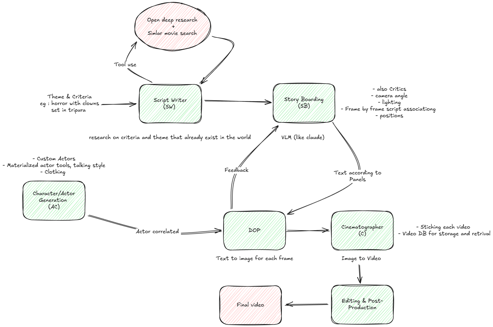

# Hitchcock - AI-Powered Movie Production Pipeline

Hitchcock is an innovative multi-agent system that automates the movie production pipeline from script to screen. Built with modern AI technologies, it orchestrates specialized agents to handle different aspects of movie production, from scriptwriting to audio synthesis.

🏆 **Winner of the [ElevenLabs Worldwide Hackathon](https://hackathon.elevenlabs.io/) in Bengaluru!**

## 🎯 Key Features

- **Automated Script Generation**: AI-powered script creation with deep research capabilities
- **Intelligent Story Boarding**: Automated scene breakdown and shot planning
- **Visual Element Planning**: Comprehensive planning of lighting, props, and atmosphere
- **Audio Synthesis**: Voice generation and audio management
- **Multi-Agent Architecture**: Specialized agents built using [Mahilo](https://github.com/wjayesh/mahilo/), a powerful multi-agent framework that enables seamless agent-to-agent communication
- **Modern Tech Stack**: Built with Python 3.8+, using cutting-edge AI and media processing libraries

## 🎬 Demo

Watch Hitchcock in action:

[](https://www.youtube.com/watch?v=O0bswr-46kg)

## 🏗 System Architecture



The system consists of the following specialized agents:

### 1. Script Writer Agent
- **Purpose**: Creates and analyzes movie scripts
- **Capabilities**:
  - Deep web research for historical/cultural context
  - Similar movie analysis for inspiration
  - Scene and dialogue generation
  - Script structure analysis
- **Tools**:
  - Web browsing and research tools
  - Text analysis and inspection
  - Scene generation and analysis
  - Research agent for deep context gathering

### 2. Story Boarding Agent
- **Purpose**: Converts scripts into detailed visual plans
- **Capabilities**:
  - Scene importance analysis
  - Shot sequence planning
  - Visual element specification
  - Camera angle and movement planning
- **Features**:
  - Automatic scene breakdown
  - Shot-by-shot planning
  - Lighting and atmosphere specification
  - Prop and special effect planning
  - Database integration for state management

### 3. Director of Photography (DOP) Agent
- **Purpose**: Handles visual implementation of story boards
- **Capabilities**:
  - Text-to-image generation
  - Scene composition
  - Visual continuity management
  - Lighting implementation
- **Features**:
  - Image generation services
  - Video sequence creation
  - Visual style consistency
  - Configuration management

### 4. Audio Agent
- **Purpose**: Manages audio synthesis and voice generation
- **Capabilities**:
  - Voice synthesis using **Eleven Labs** or **60db** (peer providers; pick via `AUDIO_PROVIDER` env)
  - Audio storage and retrieval
  - Voice consistency management
- **Features**:
  - Character voice generation
  - Audio file management
  - Integration with video pipeline

#### 60db provider (alongside ElevenLabs / litellm)

This fork adds **60db** as a peer of the existing cloud services across three concerns. One `SIXTYDB_API_KEY` unlocks all of them; each has an independent env switch so you can mix and match.

| Concern | File | Switch | 60db endpoint |
|---|---|---|---|
| **TTS** | `agents/audio/sixtydb_service.py` | `AUDIO_PROVIDER=sixtydb` | `POST /tts-synthesize` |
| **LLM** | `agents/sixtydb_llm.py` | `LLM_PROVIDER=sixtydb` | `POST /v1/chat/completions` (via litellm `openai/<model>` route) |
| **STT** | `agents/audio/sixtydb_stt_service.py` | _utility_ — no auto-wiring | `POST /stt` |

**TTS** — `SixtyDbService` mirrors `ElevenLabsService.generate_audio(text, scene_id) -> path`. The audio agent's FFmpeg pipeline globs `output/audio/SCENE_ID.mp3` regardless of which provider produced the file, so the switch is zero-touch downstream.

**LLM** — `agents.sixtydb_llm.get_litellm_model(model_id, **kwargs)` returns a `smolagents.LiteLLMModel` configured for 60db when `LLM_PROVIDER=sixtydb`, or a vanilla one otherwise. The script writer's `research_agent.py` calls through this factory, so the model the agent uses is now switchable end-to-end without touching `model_id` in code.

**STT** — Hitchcock's pipeline starts from typed text and has no audio-input agent, so `SixtyDbSTTService` ships as a utility:

```python
from agents.audio.sixtydb_stt_service import SixtyDbSTTService
idea_text = SixtyDbSTTService().transcribe("path/to/spoken_idea.wav")
```

```env
SIXTYDB_API_KEY=sk_live_...
AUDIO_PROVIDER=sixtydb                 # narration through 60db
LLM_PROVIDER=sixtydb                   # script writer through 60db
SIXTYDB_API_BASE=https://api.60db.ai   # optional
SIXTYDB_TTS_VOICE_ID=fbb75ed2-975a-40c7-9e06-38e30524a9a1
SIXTYDB_LLM_MODEL=60db-tiny
SIXTYDB_STT_LANGUAGE=auto
```

Reference: [docs.60db.ai](https://docs.60db.ai).

## 🚀 Getting Started

### Prerequisites
- Python 3.8 or higher
- `uv` package manager

### Installation

1. Install uv:
```bash
pip install uv
```

2. Clone the repository:
```bash
git clone https://github.com/ayushnangia/Hitchcock
cd hitchcock
```

3. Set up the environment:
```bash
uv venv
source .venv/bin/activate  # On Unix
# or
.venv\Scripts\activate  # On Windows
```

4. Install dependencies:
```bash
uv pip sync requirements.txt
```

### Configuration
0. Fix Mahilo in venv
add in mahilo/agent.py

in process_queue_message and process_chat_message function add
```python
                try:
                    if function_name == "contact_human":
                        function_response = await function_to_call(**function_args, websockets=websockets)

                    elif function_name == "generate_shot_images":
                        function_response = await function_to_call(**function_args)
```


1. Configure environment variables:
```bash
cp .env.template .env
# Edit .env with your API keys and configurations
```
2. Always Remove old db and sessions
```bash
sh run_db_dele.sh
``` 

3. Start the control plane:
```bash
python control_plane.py
```

4. Once the control plane is running, you can start interacting with the agents using the Mahilo CLI. Begin with the StoryWriterAgent:
```bash
mahilo connect --agent-name StoryWriterAgent
```

This will open an interactive chat session with the StoryWriterAgent. You can similarly connect to other agents:
```bash
mahilo connect --agent-name StoryBoarderAgent
mahilo connect --agent-name DOPAgent
mahilo connect --agent-name AudioAgent
```

## 📁 Project Structure

```
hitchcock/
├── control_plane.py      # Main orchestration system
├── requirements.txt      # Project dependencies
├── .env.template        # Environment variable template
├── agents/
│   ├── script_writer/   # Script Writer Agent
│   │   ├── tools.py     # Script writing tools
│   │   ├── prompt.py    # Agent prompts
│   │   ├── research_agent.py  # Research capabilities
│   │   └── scripts/     # Additional scripts
│   ├── story_boarder/   # Story Boarding Agent
│   │   ├── tools.py     # Story boarding tools
│   │   ├── prompt.py    # Agent prompts
│   │   ├── storage.py   # State management
│   │   ├── models.py    # Data models
│   │   └── db_client.py # Database operations
│   ├── dop/            # DOP Agent
│   │   ├── tools.py     # Visual tools
│   │   ├── prompt.py    # Agent prompts
│   │   ├── image_service.py  # Image generation
│   │   └── generate_story_video.py  # Video creation
│   └── audio/          # Audio Agent
│       ├── tools.py     # Audio processing tools
│       ├── prompt.py    # Agent prompts
│       ├── models.py    # Audio data models
│       └── eleven_labs_service.py  # Voice synthesis
├── assets/             # Project assets
├── downloads/          # Downloaded research materials
├── output/            # Generated content
└── sessions/          # Session management
```

## 🛠 Development

### Managing Dependencies

Add new dependencies:
```bash
uv pip install package_name
uv pip compile  # Update requirements.txt
```

Update all dependencies:
```bash
uv pip compile --upgrade
uv pip sync
```

Test with minimum versions:
```bash
uv pip compile --resolution=lowest
uv pip sync
```

### Running Individual Components

Run script writer:
```bash
python run_script_writer.py
```

### Database Management

Manage database:
```bash
./run_db_dele.sh
```

## 📝 License

MIT

---
*Note: This is an active development project. Features and capabilities may change as development progresses.*
